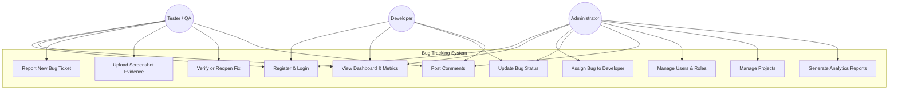
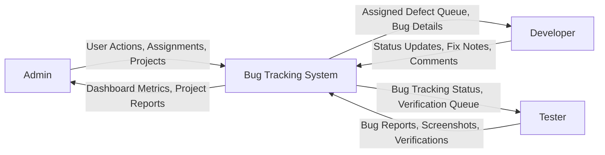
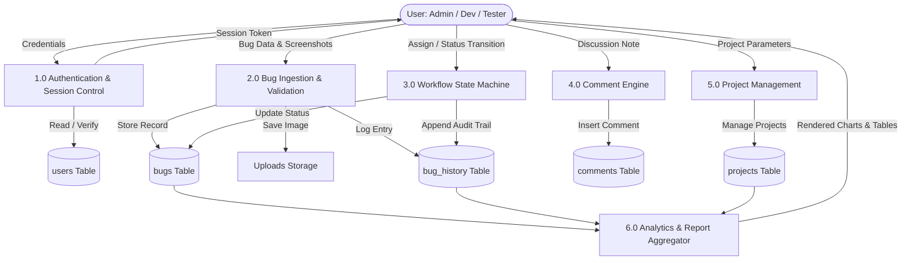
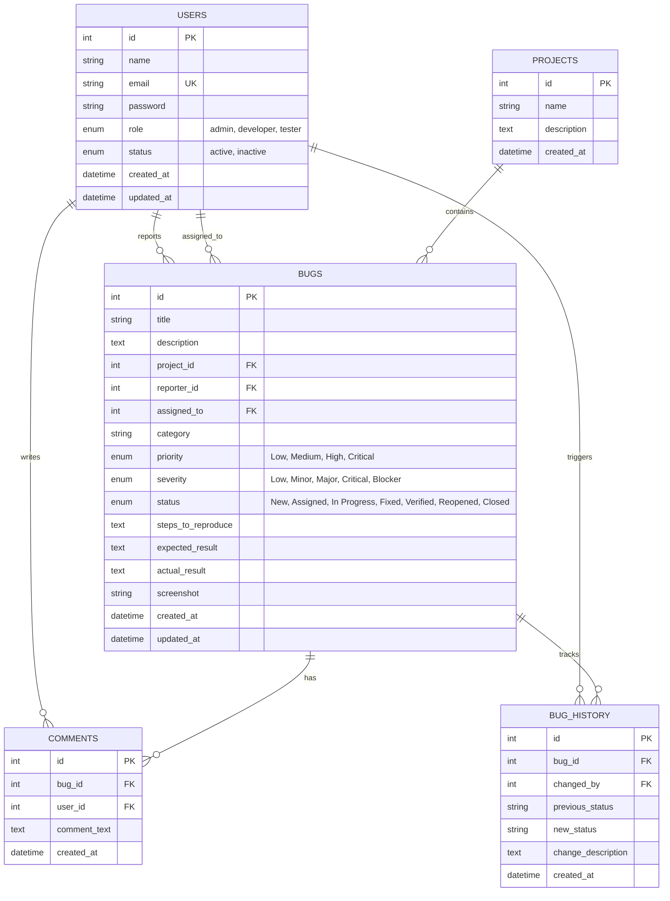
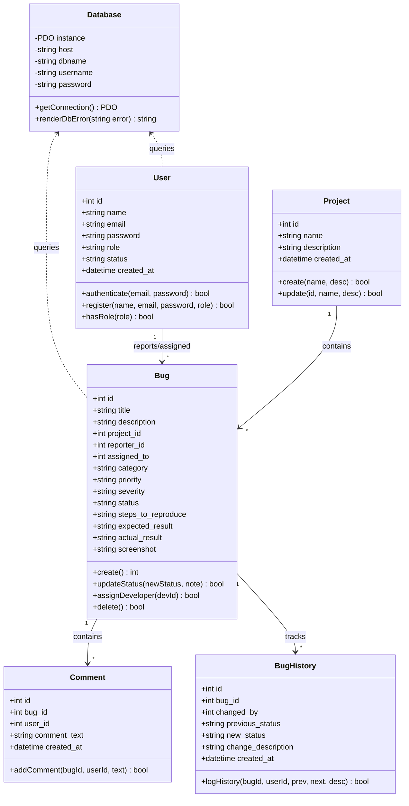
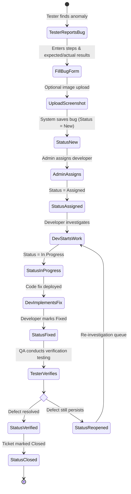
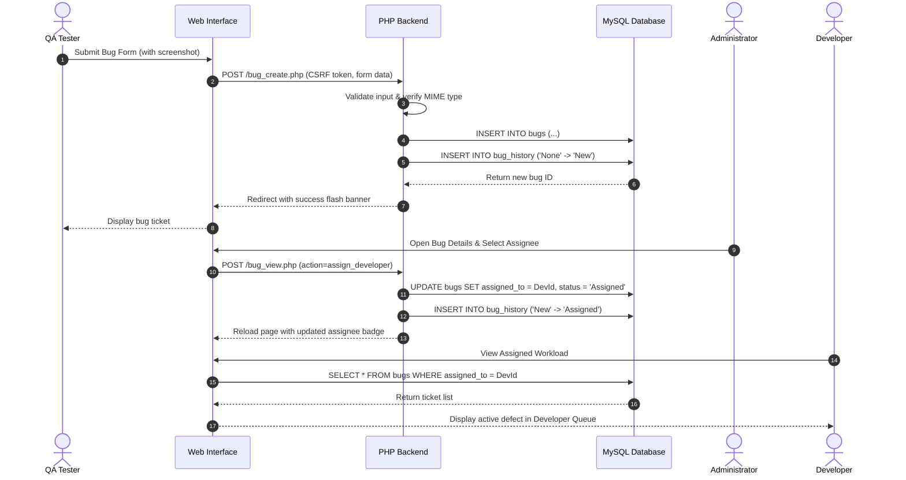
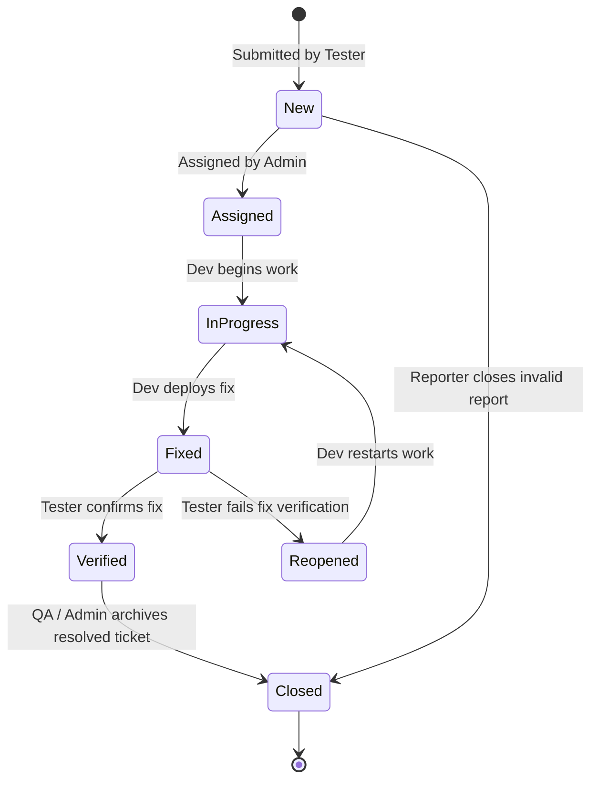

# Software Engineering Mini-Project Documentation
## Bug Tracking System (BugTrace)

---

### Table of Contents
1. [Abstract](#1-abstract)
2. [Introduction](#2-introduction)
3. [Problem Statement](#3-problem-statement)
4. [Objectives](#4-objectives)
5. [Scope of the Project](#5-scope-of-the-project)
6. [Existing System vs. Proposed System](#6-existing-system-vs-proposed-system)
7. [Feasibility Study](#7-feasibility-study)
8. [Software Requirements Specification (SRS)](#8-software-requirements-specification-srs)
   - 8.1 Functional Requirements
   - 8.2 Non-Functional Requirements
   - 8.3 Hardware & Software Requirements
9. [System Modeling & UML Diagrams](#9-system-modeling--uml-diagrams)
   - 9.1 Use Case Diagram
   - 9.2 Data Flow Diagram (DFD Level 0 - Context Diagram)
   - 9.3 Data Flow Diagram (DFD Level 1)
   - 9.4 Entity-Relationship (ER) Diagram
   - 9.5 Class Diagram
   - 9.6 Activity Diagram (Bug Reporting & Resolution Lifecycle)
   - 9.7 Sequence Diagram (Bug Reporting & Assignment)
   - 9.8 State Transition Diagram (Bug Workflow)
10. [Database Schema & Data Dictionary](#10-database-schema--data-dictionary)
11. [Software Testing & Test Cases](#11-software-testing--test-cases)
12. [Limitations & Future Enhancements](#12-limitations--future-enhancements)
13. [Conclusion](#13-conclusion)
14. [References](#14-references)

---

## 1. Abstract
In modern software engineering, defect management and quality assurance are paramount to delivering dependable software systems. The **Bug Tracking System (BugTrace)** is a responsive, web-based platform developed using PHP, MySQL, and modern Vanilla CSS/JavaScript. It provides an end-to-end framework enabling QA testers, developers, and project administrators to record, triage, assign, resolve, and audit software defects.

The system enforces strict role-based access control (RBAC), robust input sanitization, cross-site request forgery (CSRF) defenses, password hashing (bcrypt), and parameterized PDO database operations. An auditable defect state machine (New &rarr; Assigned &rarr; In Progress &rarr; Fixed &rarr; Verified &rarr; Reopened &rarr; Closed) tracks every status transition alongside actor details and timestamps. Standalone Canvas-based analytics and comprehensive search/filter capabilities empower engineering teams with continuous visibility into defect density and developer workloads.

---

## 2. Introduction
Software development is an iterative, multi-stakeholder discipline where bugs and anomalies naturally emerge across requirements analysis, coding, and integration phases. Without a centralized tracking utility, development teams frequently face missed defects, duplicate issue reports, ambiguous reproduction procedures, and misallocated engineering time.

The **Bug Tracking System** establishes an integrated digital workspace that bridges communication between testers who uncover defects and developers tasked with rectifying them. By standardizing reproduction steps, severity categorizations, screenshot attachments, and historical audit trails, the application accelerates mean time to resolution (MTTR) while maintaining rigorous transparency throughout the software development life cycle (SDLC).

---

## 3. Problem Statement
Many small development teams and academic capstone teams rely on informal issue logging tools, such as shared spreadsheets, email chains, or instant messaging channels. This decentralized approach introduces critical vulnerabilities and operational hurdles:
- **Lack of Traceability:** Inability to track who modified a ticket or when a defect moved between stages.
- **Ambiguous Defect Descriptions:** Missing structured steps to reproduce, expected results, and actual outcomes.
- **Unclear Accountability:** Developers unsure of their active queues, and testers unaware of when fixes are deployed.
- **Lack of Role Segregation:** Vulnerability to accidental alterations or unauthorized modifications of ticket states.
- **Absence of Quantitative Metrics:** Difficulty evaluating bug distribution by severity, priority, or project component.

---

## 4. Objectives
The core objectives of the Bug Tracking System are:
1. To implement a secure web application utilizing PHP and MySQL adhering to the Model-View-Controller/Modular architecture.
2. To provide separate, tailored dashboards for **Administrators**, **Developers**, and **Testers**.
3. To enforce a structured defect life cycle (*New &rarr; Assigned &rarr; In Progress &rarr; Fixed &rarr; Verified &rarr; Reopened &rarr; Closed*).
4. To maintain an immutable audit trail (`bug_history`) capturing every status shift and resolution note.
5. To facilitate screenshot attachment uploads with MIME type and size validation.
6. To enable real-time sorting, multi-criteria filtering, and pagination over bug repositories.
7. To deliver zero-dependency visual analytics displaying status distribution and developer workload.

---

## 5. Scope of the Project
The project encompasses:
- **Authentication & User Management:** Secure registration, authentication, role assignment (Admin, Developer, Tester), account status toggling, and password updates.
- **Defect Lifecycle Management:** Submission, categorization, priority/severity ranking, developer assignment, and status transitions.
- **Communication & Audit Trails:** Real-time commenting threads and timestamped historical status timelines.
- **Project Governance:** Creation and monitoring of distinct software projects.
- **Analytics & Reporting:** Interactive canvas graphs, defect density summaries, and exportable reports.
- **Operational Boundaries:** Designed for internal engineering networks and local XAMPP environments without reliance on external cloud APIs or paid services.

---

## 6. Existing System vs. Proposed System

| Dimension | Existing System (Spreadsheets / Chats) | Proposed System (BugTrace) |
|---|---|---|
| **Storage & Integrity** | Decentralized, prone to accidental overrides | Centralized relational MySQL with foreign keys |
| **Workflow Enforcement** | Ad-hoc, manual status labeling | Regulated state machine with role-level guardrails |
| **Access Control** | No granular roles or permissions | Strict Role-Based Access Control (Admin, Dev, Tester) |
| **Audit Trail** | Untracked edits and deleted comments | Automated `bug_history` table recording every transition |
| **Evidence Attachment** | File paths broken or scattered in email | Secure file uploads with unique hashed filenames |
| **Security** | Plain text storage, zero CSRF/XSS defense | Bcrypt password hashing, PDO prepared statements, CSRF tokens |
| **Analytics** | Manual tallying and spreadsheet formulas | Automated real-time canvas visualizations and workload ranking |

---

## 7. Feasibility Study

### 7.1 Technical Feasibility
The system utilizes mature, globally adopted web standards: HTML5, CSS3, JavaScript, PHP 8.x, and MySQL. PHP’s native PDO module guarantees safe database connectivity, and modern browsers natively execute the canvas charting engine without third-party dependencies.

### 7.2 Operational Feasibility
The user interface adheres to standard ergonomic web patterns (responsive sidebar, topbar, cards, and modal dialogs). Users require no specialized training; testers follow structured forms with guided placeholders, while developers update tickets via intuitive drop-down controls.

### 7.3 Economic Feasibility
The entire technology stack is open-source (Apache, PHP, MySQL via XAMPP). Development and deployment carry zero licensing or recurring API costs.

### 7.4 Schedule Feasibility
The project was designed with a modular structure (Config &rarr; Auth &rarr; Database &rarr; Views &rarr; Analytics &rarr; Testing), ensuring completion within academic timelines.

---

## 8. Software Requirements Specification (SRS)

### 8.1 Functional Requirements
- **FR1 (Authentication):** Users must authenticate with valid email and password credentials.
- **FR2 (Role Authorization):** Only Admins may manage users and reassign tickets; only assigned Developers may move bugs to *In Progress* or *Fixed*; only Testers may mark bugs as *Verified* or *Reopened*.
- **FR3 (Bug Reporting):** Testers must be able to file bugs with title, project, category, priority, severity, description, reproduction steps, expected/actual results, and optional screenshots.
- **FR4 (File Validation):** Uploaded attachments must be restricted to image MIME types (JPG, PNG, GIF, WebP) and maximum 5 MB in file size.
- **FR5 (Status Transitions):** Every status change must create an immutable entry in `bug_history`.
- **FR6 (Comments):** Users must be able to post threaded comments on bug detail pages.
- **FR7 (Search & Filtering):** The system must filter tickets across keyword, project, status, priority, and assignee.
- **FR8 (Metrics & Reporting):** The system must generate visual graphs summarizing tickets by status, priority, and developer workload.

### 8.2 Non-Functional Requirements
- **NFR1 (Security):** All SQL queries must execute through PDO prepared statements with zero string concatenation. Forms must include CSRF tokens. All displayed outputs must be sanitized using `htmlspecialchars()`. Passwords must be hashed using `password_hash()` (bcrypt).
- **NFR2 (Usability):** Layout must be responsive across mobile (max 640px), tablet (max 992px), and desktop screen resolutions.
- **NFR3 (Performance):** Page queries must respond within 150ms on standard local web servers (XAMPP).
- **NFR4 (Reliability):** Database constraints (foreign keys with cascade/restrict rules) must preserve data integrity under all operations.

### 8.3 Hardware & Software Requirements
- **Hardware:**
  - Processor: Intel Core i3 / AMD Ryzen 3 or higher
  - RAM: Minimum 4 GB RAM (8 GB recommended)
  - Disk Space: 500 MB free hard drive space
- **Software:**
  - Operating System: Windows 10/11, Linux, or macOS
  - Local Web Server: XAMPP (Apache 2.4+ and MySQL 8.0+ / MariaDB 10.4+)
  - PHP Engine: PHP 8.1 or PHP 8.2 (with PDO, PDO_MySQL, and FileInfo extensions enabled)
  - Browser: Google Chrome, Mozilla Firefox, Microsoft Edge, or Safari
  - Code Editor: Visual Studio Code

---

## 9. System Modeling & UML Diagrams

### 9.1 Use Case Diagram

---

### 9.2 Data Flow Diagram (DFD Level 0 - Context Diagram)

---

### 9.3 Data Flow Diagram (DFD Level 1)

---

### 9.4 Entity-Relationship (ER) Diagram

---

### 9.5 Class Diagram

---

### 9.6 Activity Diagram (Bug Reporting & Resolution Lifecycle)

---

### 9.7 Sequence Diagram (Bug Reporting & Assignment)

---

### 9.8 State Transition Diagram (Bug Workflow)

---

## 10. Database Schema & Data Dictionary

### Table: `users`
| Column | Data Type | Key | Nullable | Description |
|---|---|---|---|---|
| `id` | INT AUTO_INCREMENT | PK | NO | Unique user primary identifier |
| `name` | VARCHAR(100) | | NO | Full name of the user |
| `email` | VARCHAR(150) | UK | NO | Unique login email address |
| `password` | VARCHAR(255) | | NO | Bcrypt password hash string |
| `role` | ENUM('admin','developer','tester') | | NO | System role determining privileges |
| `status` | ENUM('active','inactive') | | NO | Operational account state |
| `created_at` | TIMESTAMP | | NO | Account registration timestamp |
| `updated_at` | TIMESTAMP | | NO | Last profile modification timestamp |

### Table: `projects`
| Column | Data Type | Key | Nullable | Description |
|---|---|---|---|---|
| `id` | INT AUTO_INCREMENT | PK | NO | Unique project primary identifier |
| `name` | VARCHAR(150) | | NO | Software project name |
| `description` | TEXT | | YES | Overview of project scope |
| `created_at` | TIMESTAMP | | NO | Project creation timestamp |

### Table: `bugs`
| Column | Data Type | Key | Nullable | Description |
|---|---|---|---|---|
| `id` | INT AUTO_INCREMENT | PK | NO | Unique bug ticket primary identifier |
| `title` | VARCHAR(255) | | NO | Concise defect summary |
| `description` | TEXT | | NO | Comprehensive problem description |
| `project_id` | INT | FK | NO | Target project foreign key |
| `reporter_id` | INT | FK | NO | Reporter user foreign key |
| `assigned_to` | INT | FK | YES | Assigned developer user foreign key |
| `category` | VARCHAR(50) | | NO | Classification category (UI, API, etc.) |
| `priority` | ENUM('Low','Medium','High','Critical') | | NO | Urgency of resolution |
| `severity` | ENUM('Low','Minor','Major','Critical','Blocker') | | NO | Functional impact severity |
| `status` | ENUM('New','Assigned','In Progress','Fixed','Verified','Reopened','Closed') | | NO | Active lifecycle state |
| `steps_to_reproduce` | TEXT | | YES | Numbered instructions to reproduce |
| `expected_result` | TEXT | | YES | Anticipated specification behavior |
| `actual_result` | TEXT | | YES | Observed erroneous behavior |
| `screenshot` | VARCHAR(255) | | YES | Stored filename of image evidence |
| `created_at` | TIMESTAMP | | NO | Ticket filing timestamp |
| `updated_at` | TIMESTAMP | | NO | Last modification timestamp |

### Table: `comments`
| Column | Data Type | Key | Nullable | Description |
|---|---|---|---|---|
| `id` | INT AUTO_INCREMENT | PK | NO | Primary key for comment |
| `bug_id` | INT | FK | NO | Associated bug ticket |
| `user_id` | INT | FK | NO | Author user foreign key |
| `comment_text` | TEXT | | NO | Message content |
| `created_at` | TIMESTAMP | | NO | Comment submission timestamp |

### Table: `bug_history`
| Column | Data Type | Key | Nullable | Description |
|---|---|---|---|---|
| `id` | INT AUTO_INCREMENT | PK | NO | History audit log identifier |
| `bug_id` | INT | FK | NO | Associated bug ticket |
| `changed_by` | INT | FK | NO | User who executed the change |
| `previous_status`| VARCHAR(50) | | NO | Previous status state string |
| `new_status` | VARCHAR(50) | | NO | Updated status state string |
| `change_description`| TEXT | | YES | Note explaining the modification |
| `created_at` | TIMESTAMP | | NO | Timestamp of state transition |

---

## 11. Software Testing & Test Cases

The application underwent rigorous verification covering positive, negative, and role-boundary test scenarios.

| Test ID | Test Scenario | Input Data | Expected Result | Actual Result | Status |
|---|---|---|---|---|---|
| **TC01** | User Registration with Valid Data | Name: "John Doe", Email: "john@test.com", Password: "password123" | Account created in DB with role 'tester'; redirect to login | Account created, redirected to login with success flash | **PASS** |
| **TC02** | User Registration with Duplicate Email | Email: "admin@bugtrace.com" | Registration rejected with error "An account with this email already exists" | Error banner displayed; DB insert blocked | **PASS** |
| **TC03** | User Login with Valid Credentials | Email: "admin@bugtrace.com", Password: "admin123" | Session started with role 'admin'; redirect to dashboard | Authenticated successfully; admin dashboard rendered | **PASS** |
| **TC04** | User Login with Invalid Password | Email: "admin@bugtrace.com", Password: "wrongpassword" | Authentication denied; error displayed | "Invalid email address or password" displayed | **PASS** |
| **TC05** | Deactivated Account Login Attempt | Deactivated user credentials | Login denied with account deactivation notice | "This account has been deactivated" displayed | **PASS** |
| **TC06** | Role-Based Page Restriction | Logged-in Tester navigates to `users.php` | Access blocked; redirect to dashboard with danger flash | Redirected to dashboard; "Access denied" alert shown | **PASS** |
| **TC07** | Bug Reporting with Valid Details & Image | Title: "Null pointer on checkout", Project: 1, Priority: High, Valid PNG image | Bug inserted with status 'New', image stored in `uploads/`, history logged | Bug #8 created; screenshot displayed; history recorded | **PASS** |
| **TC08** | Bug Reporting with Oversized Screenshot | Image size > 5 MB | Upload rejected with error notification | "Screenshot file size exceeds 5 MB limit" displayed | **PASS** |
| **TC09** | Malicious Script File Upload | File: `shell.php` renamed or MIME manipulated | Upload rejected; file not executed | Rejected by finfo MIME validation; upload halted | **PASS** |
| **TC10** | Admin Assigns Bug to Developer | Admin selects Dev "Alex Rivera" for Bug #1 | Assigned developer updated to Alex; status changed to 'Assigned' | Assignment saved; status history entry created | **PASS** |
| **TC11** | Developer Updates Status to In Progress | Developer Alex changes status of Bug #1 from 'Assigned' to 'In Progress' | Status updated to 'In Progress'; audit trail logged | Status updated; timeline dot and note rendered | **PASS** |
| **TC12** | Developer Marks Bug as Fixed | Developer Alex updates status from 'In Progress' to 'Fixed' | Status updated to 'Fixed'; submitted for QA verification | Status updated; badge turned emerald green | **PASS** |
| **TC13** | Tester Verifies Resolved Bug | Tester marks Bug #2 as 'Verified' | Status updated to 'Verified' | Status updated to 'Verified'; logged in history | **PASS** |
| **TC14** | Tester Reopens Bug with Persistent Defect | Tester marks Bug #6 as 'Reopened' | Status changed to 'Reopened'; visible in Dev queue | Status changed to 'Reopened'; red rose badge displayed | **PASS** |
| **TC15** | Threaded Discussion Comment | User submits comment text on bug detail view | Comment persisted in DB and rendered with user role badge | Comment displayed with avatar and relative timestamp | **PASS** |
| **TC16** | Bug Filtering & Keyword Search | Search keyword "Gateway", Priority "Critical" | Table lists only Bug #1 | Table filters down to 1 matching record | **PASS** |
| **TC17** | CSRF Protection on Status Modification | POST request without valid `csrf_token` | Request rejected; status unchanged | HTTP redirected with "Security validation failed" | **PASS** |
| **TC18** | User Logout | User clicks logout link | Session destroyed; user redirected to login page | Session emptied; cookie invalidated; login page shown | **PASS** |

---

## 12. Limitations & Future Enhancements

### 12.1 Current Limitations
1. **Email Notifications:** The local system does not dispatch external SMTP emails on ticket assignment.
2. **Multiple Attachments:** Currently, a single screenshot attachment is supported per bug ticket.
3. **Single Assignee:** Defects can be assigned to one primary developer at a time.

### 12.2 Future Enhancements
1. **Automated Email & Push Notifications:** Integrating PHPMailer or WebSockets for instant desktop notifications.
2. **Git Repository Integration:** Linking commits and pull requests (GitHub/GitLab) directly to Bug IDs via regex webhooks.
3. **Kanban Board View:** An interactive drag-and-drop board for visual triage across status columns.
4. **Export to PDF & CSV:** Dedicated server-side PDF generator for formal compliance audits.

---

## 13. Conclusion
The **Bug Tracking System (BugTrace)** successfully fulfills all academic and functional requirements of a Software Engineering mini-project. By employing clean modular PHP, secure PDO database abstractions, and responsive CSS, the application delivers a resilient, secure platform for defect management. The structured workflow transitions, comprehensive audit trails, and zero-dependency analytics equip development teams with the transparency needed to elevate software quality.

---

## 14. References
1. Pressman, R. S., & Maxim, B. R. (2020). *Software Engineering: A Practitioner's Approach* (9th ed.). McGraw-Hill Education.
2. Sommerville, I. (2015). *Software Engineering* (10th ed.). Pearson.
3. The PHP Group. (2024). *PHP: Hypertext Preprocessor Documentation (PDO & Password Hashing)*. Retrieved from [php.net](https://www.php.net).
4. OWASP Foundation. (2024). *OWASP Top 10 Web Application Security Risks*. Retrieved from [owasp.org](https://owasp.org).
5. MySQL Documentation. (2024). *MySQL 8.0 Reference Manual*. Oracle Corporation.
